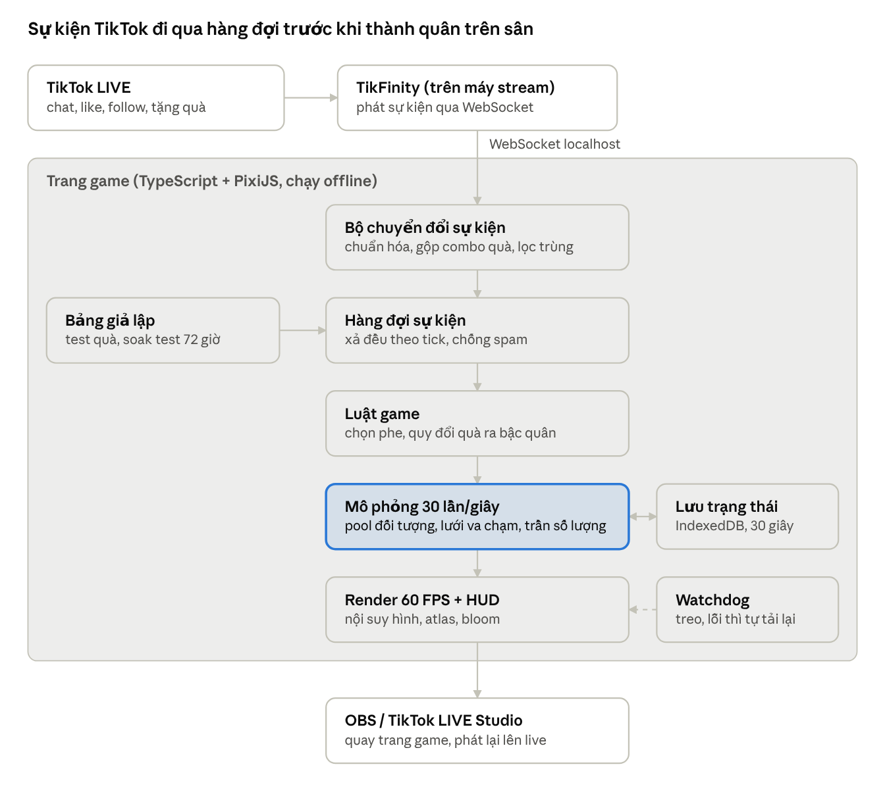
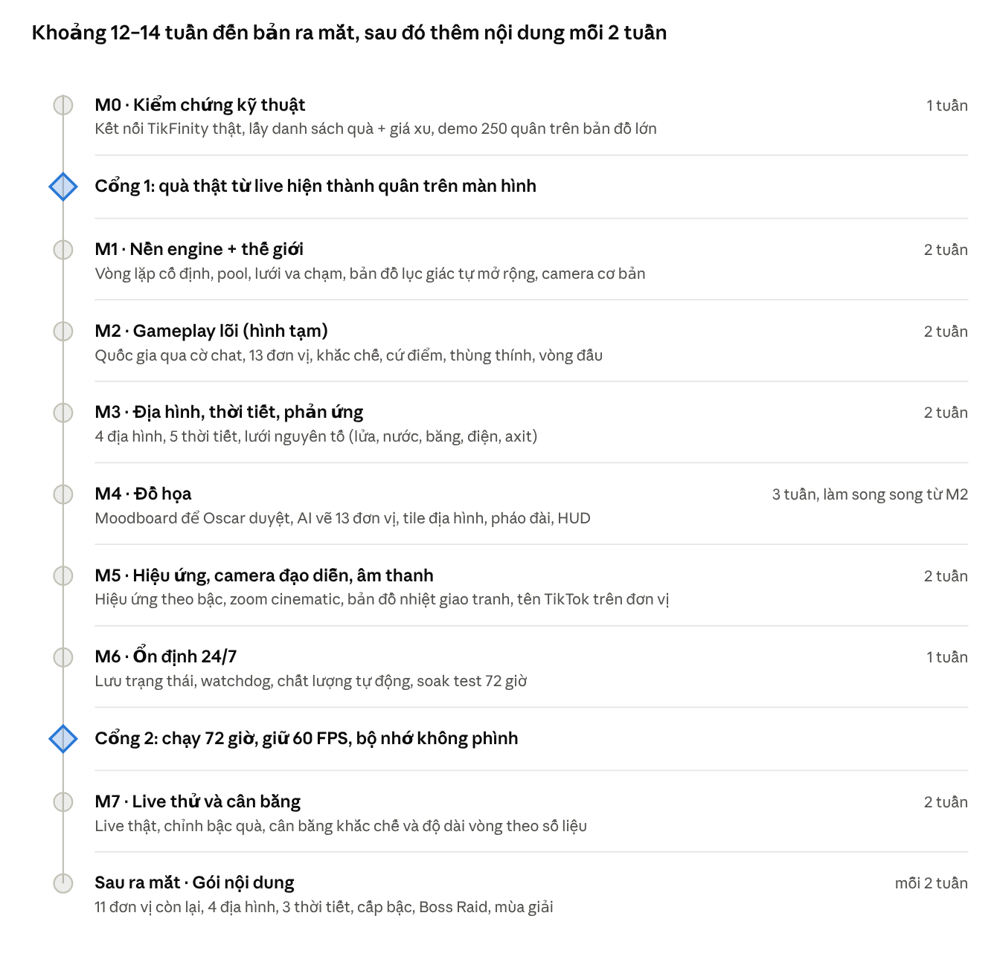

# Kế hoạch phát triển Cyber Mecha Country Wars

Cập nhật: 03/11/2026 · Người yêu cầu: Oscar

> Bản gốc (có thể chỉnh sửa, bình luận): https://claude.ai/artifact/6e9xfAc9cfLf85tWnGXPkg

## Đánh giá ý tưởng: đủ "đã mắt", còn thiếu lý do để donate tiếp

Kết luận: 8 ý của Oscar rất mạnh về phần nhìn (đa dạng, hoành tráng, zoom cinematic), đủ để người xem dừng lướt và donate lần đầu. Để họ donate lần 2, lần 10, game cần thêm 4 thứ mà bản kế hoạch này đã bổ sung.

| Yếu tố kích donate | Ý tưởng của Oscar | Đánh giá | Bổ sung |
| --- | --- | --- | --- |
| Được thấy, được khoe (pay-to-flex) | Zoom vào đơn vị, tên TikTok trên đơn vị, máy xịn hiệu ứng nhiều | Rất mạnh | Khung tên và hiệu ứng riêng theo cấp bậc người chơi |
| Tự hào dân tộc, đối đầu nước với nước | Mỗi nước có pháo đài riêng | Mạnh | Bảng xếp hạng quốc gia theo mùa, kèo "VN vs TH" khi 2 nước giành nhau |
| Khoảnh khắc gấp (phải tặng ngay) | Cứ điểm, thời tiết | Trung bình | SOS pháo đài, boss raid, 60 giây cuối vòng nhân đôi |
| Chiến thuật (tặng đúng quà) | Đa dạng đơn vị, địa hình, thời tiết | Tiềm năng lớn | Hệ khắc chế rõ ràng: địch có máy bay thì phải gọi phòng không |
| Tích lũy, nâng cấp lâu dài | Chưa có | Thiếu | Cấp bậc quân hàm tích theo tổng xu, mở khóa đơn vị và skin xịn hơn |
| Người xem miễn phí cũng có việc làm | Thùng thính | Tốt | Like đủ mốc thì thả thùng, chat để nhận lính |

**Điểm cần cân nhắc:**

- **IP quốc gia không làm được.** TikTok không cung cấp IP hay vị trí người xem cho streamer, TikFinity cũng không có. Thay thế: người xem gõ cờ hoặc mã nước vào chat (chi tiết ở mục Quốc gia).
- **Quá nhiều thứ cùng lúc sẽ rối trên màn hình điện thoại.** Người xem lướt qua chỉ có 1–2 giây để hiểu chuyện gì đang xảy ra. Giải pháp: mỗi thời điểm chỉ 1 địa hình chính + 1 thời tiết, biểu tượng lớn dễ hiểu, camera luôn kể 1 câu chuyện.
- **Đa dạng tối đa nhưng ra mắt theo đợt.** Bản đầu ra với 13 đơn vị, 4 địa hình, 5 thời tiết. Sau đó mỗi 2 tuần thêm 1 gói nội dung (đơn vị, bản đồ, sự kiện mới). Vừa ra mắt sớm hơn, vừa cho người xem cũ lý do quay lại.

## Hiện trạng: prototype đẹp ý tưởng nhưng chưa chịu được live 24/7

Đề xuất: dùng prototype của Gemini làm ý tưởng gốc chứ không dùng lại code, và mở rộng theo 8 ý của Oscar (quốc gia không giới hạn, nhiều loại đơn vị, địa hình, thời tiết, camera, cứ điểm). Engine viết lại từ đầu, vì bản HTML hiện tại có nhiều điểm sẽ gây giật lag và rò bộ nhớ khi treo lâu.

**Thứ đã có (giữ lại làm spec):**

- Khung dọc 9:16, 4 phe đóng 4 góc: USA, UK, Brazil, Japan, mỗi pháo đài 5.000 HP.
- 5 cấp quân theo quà: Chat (miễn phí) lính bộ binh, Rose 1 xu, Heart 10 xu, Donut 30 xu (boss + hồi 500 HP), Galaxy 1.000 xu (rồng + nuke -1.400 HP lên mọi căn cứ địch).
- Cơ chế kích donate: Ngai vàng World Emperor cho top donator, cảnh báo SOS khi căn cứ dưới 25% HP, cut-in toàn màn hình cho Galaxy, Lõi Năng Lượng giữa sân.
- Âm thanh tổng hợp bằng Web Audio, cổng WebSocket `ws://localhost:8080`, bảng giả lập bên phải để test.
- Hai file HTML trong thư mục giống hệt nhau (cùng 65 KB), nên thực tế chỉ có 1 bản code.

**Vấn đề kỹ thuật tìm thấy trong code:**

| Vấn đề | Hậu quả khi live 24/7 |
| --- | --- |
| Dùng `shadowBlur` của Canvas 2D cho glow ở hàng chục chỗ | Rất tốn GPU/CPU, tụt FPS khi đông quân |
| Hạt, mảnh vỡ, vỏ đạn dùng `push` / `splice`, không có pool | Rác bộ nhớ liên tục, giật theo chu kỳ dọn rác |
| Va chạm so từng cặp O(n²), `units.filter` mỗi frame | 100 quân = ~5.000 phép so mỗi frame |
| Không có delta time, logic chạy theo số frame | Màn hình 144 Hz chạy nhanh gấp 2,4 lần, game lệch tốc độ |
| Không giới hạn quân từ quà thật (chỉ bot tự động có giới hạn 70) | Một đợt spam quà có thể làm treo máy |
| Sổ donator tăng mãi, không có vòng đấu reset | Bộ nhớ phình theo thời gian |
| Tải Tailwind bằng CDN dạng play, avatar lấy từ dicebear.com | Phụ thuộc mạng, chậm khởi động, rủi ro khi mất mạng |
| Sự kiện WebSocket yêu cầu sẵn `country` và `tier` | TikFinity không gửi phe, cần lớp chuyển đổi và cơ chế chọn phe |

## Công nghệ: PixiJS v8 + TypeScript, chạy như một trang web trên máy stream

Game vẫn là trang web (để nhúng vào TikTok LIVE Studio hoặc OBS dạng browser source), nhưng chuyển từ Canvas 2D sang WebGL qua PixiJS. WebGL vẽ hàng nghìn sprite trong vài lần gọi GPU, nên vừa đẹp hơn vừa nhẹ hơn Canvas 2D rất nhiều.

| Thành phần | Lựa chọn | Lý do |
| --- | --- | --- |
| Render | PixiJS v8 (WebGL, tự chuyển WebGPU khi có) | Batch sprite, ParticleContainer cho hàng nghìn hạt, blend mode cộng sáng thay cho shadowBlur |
| Ngôn ngữ | TypeScript | Code lớn dần, bắt lỗi sớm, dễ bảo trì |
| Build | Vite | Ra 1 thư mục tĩnh, chạy offline, không cần CDN |
| Đồ họa | Vector vẽ bằng code, nướng thành texture atlas lúc khởi động + rig nhiều bộ phận tự viết | Mỗi mecha là các mảnh thân, vai, tay, chân quay độc lập, không cần mua Spine |
| Hiệu ứng sáng | Bloom nhẹ 1 lần cho cả màn hình, hoặc glow vẽ sẵn vào sprite | Glow đẹp mà chi phí cố định, không tăng theo số quân |
| Âm thanh | Howler.js + file âm thanh nén (ogg/mp3) | Âm thanh thật hay hơn synth, có giới hạn số tiếng cùng lúc |
| HUD | DOM/CSS nhẹ phủ lên canvas (ngai vàng, feed, bảng quà) | Chữ sắc nét, dễ chỉnh; cập nhật tối đa vài lần/giây |
| Lưu trạng thái | IndexedDB | Lưu bảng xếp hạng và vòng đấu, tải lại trang vẫn giữ được |

Phương án đã cân nhắc và loại: Three.js (3D đẹp nhưng nặng hơn, tốn công làm model), Unity/Godot bản desktop (mạnh nhưng mất sự đơn giản của browser source và tốn thời gian hơn). Nếu sau này cần đóng gói thành app riêng, có thể bọc bằng Electron mà không viết lại.

Độ phân giải: bản cũ là 460×818 px, quá thấp cho stream. Bản mới vẽ ở 1080×1920 (9:16) để hình nét trên điện thoại, có nút hạ xuống 720×1280 nếu máy yếu.

## Kiến trúc: game nối thẳng vào TikFinity, không cần server riêng

TikFinity chạy trên máy stream, giữ kết nối với TikTok LIVE và phát lại sự kiện qua WebSocket nội bộ. Trang game kết nối thẳng vào đó, nên không cần Node.js server trung gian như bản cũ (`ws://localhost:8080`). Ít thành phần hơn thì ít chỗ hỏng hơn khi chạy 24/7.

Mọi sự kiện đều đi qua bộ chuyển đổi và hàng đợi trước khi chạm vào game, nên spam quà không thể làm tụt frame. Bảng giả lập đẩy sự kiện vào đúng hàng đợi đó, nên test và live thật chạy cùng một đường code.

**Bộ chuyển đổi** có 3 việc:

- Đổi sự kiện TikFinity (chat, gift, like, follow, share) thành 1 kiểu sự kiện chung của game, ghi kèm id người xem, tên, avatar.
- Xử lý combo quà: quà bấm liên tục (ví dụ Rose x20) chỉ tính khi combo kết thúc, tránh đếm trùng.
- Đọc bảng quy đổi quà → bậc quân từ file cấu hình JSON, để đổi giá hoặc thêm quà mà không sửa code.

Nếu sau này cần thêm nguồn khác (ví dụ TikTok-Live-Connector), chỉ cần viết thêm 1 bộ chuyển đổi, phần còn lại giữ nguyên.

## Quốc gia: nước nào có người chơi thì mọc pháo đài, bản đồ nở ra theo

Không giới hạn số nước. Nước đầu tiên có người tham gia sẽ được dựng pháo đài kèm hiệu ứng "hạ cánh", và bản đồ nở thêm 1 vùng để chứa nó.

**Cách biết người xem ở nước nào (thay cho IP):**

1. Người xem gõ cờ emoji (🇻🇳, 🇺🇸, 🇯🇵…) hoặc mã nước (`vn`, `us`, `jp`…) vào chat. Game nhớ lựa chọn này lâu dài, không cần gõ lại mỗi vòng.
2. Ai tặng quà mà chưa chọn nước thì vào phe "Lính đánh thuê" (không cờ), và màn hình nhắc họ gõ cờ để về đúng nước. Quà không bao giờ bị mất.
3. Mỗi người được đổi nước tối đa 1 lần/ngày, chống nhảy phe khi nước mình sắp thua.

Khai báo bằng tay có lợi hơn IP: gõ cờ là một tương tác, làm chat sôi động và được thuật toán TikTok tính điểm.

**Bản đồ mở rộng:** thế giới gồm các "vùng" lục giác ghép lại. Bắt đầu 4 vùng, mỗi nước mới thêm 1 vùng ở rìa, camera tự lùi ra. Cuối vòng, bản đồ thu lại theo số nước còn hoạt động.

**Giữ màn hình dễ đọc khi có 20, 30 nước:**

- **Nước hoạt động** (có tương tác trong 10 phút gần nhất) có pháo đài đầy đủ. Pháo đài to lên theo tổng xu nước đó đã nhận.
- **Nước ngủ** (không ai tương tác) thu nhỏ thành tiền đồn, không bị phá hủy, và thức dậy ngay khi có người gõ cờ.
- Tối đa khoảng 12 pháo đài đầy đủ cùng lúc (số khởi điểm, chỉnh khi test). Quá số đó, nước ít hoạt động nhất chuyển sang tiền đồn.
- Bản đồ nhỏ góc màn hình cho thấy toàn cảnh, camera chính luôn chỉ bám 1–2 nơi đang nóng (xem mục Camera).

Hình ảnh quốc gia chỉ dùng cờ và màu, không dùng hình ảnh chính trị, lãnh tụ hay biếm họa dân tộc, để game không bị báo cáo.

## Đơn vị chiến đấu: 24 loại chia 7 bậc quà, có hệ khắc chế

Quà được xếp bậc theo số xu thay vì gắn cứng từng món, nên món quà mới nào TikTok ra cũng tự vào đúng bậc. Mỗi bậc có nhiều đơn vị: người xem chọn trước bằng lệnh chat (ví dụ `!tank`, `!air`), không chọn thì game tự gọi đơn vị khắc chế quân địch đang đông nhất.

| Bậc | Quà (xu) | Đơn vị | Hiệu ứng khi ra sân |
| --- | --- | --- | --- |
| 0 | Chat, Follow, Share | Bộ binh súng trường (chat), Lính bắn tỉa (follow), Lính tên lửa chống tăng (share) | Nhảy dù nhỏ, tên hiện 3 giây |
| 1 | 1–9 (Rose…) | Drone tự sát, Lính phun lửa, Xe jeep súng máy | Thả từ trực thăng vận tải |
| 2 | 10–99 | Xe tăng hạng nhẹ, Xe phòng không, Nhện máy, Drone kỹ sư (sửa chữa đồng đội) | Khói màu phe, tên cố định trên đầu |
| 3 | 100–499 | Xe tăng chủ lực, Pháo phản lực MLRS, Trực thăng tấn công, Xe EMP | Banner tên + avatar, rung nhẹ |
| 4 | 500–4.999 | Robot chiến đấu cỡ lớn, Máy bay chiến đấu ném bom (rải bom 1 dải rộng), Tàu đổ bộ đệm khí (đi được trên nước, đầm lầy), Pháo đài di động | Camera zoom nhanh, cut-in nhỏ |
| 5 | 5.000–29.999 | Mecha Titan, Tàu sân bay drone trên không, Pháo đài bão táp (đổi thời tiết quanh nó) | Zoom + slow-motion 2 giây, cut-in toàn màn hình |
| 6 | từ ~30.000 (Sư tử, Universe) | Oanh tạc chiến lược (xóa sạch 1 vùng lớn), Pháo quỹ đạo, Rồng Mecha | Chế độ "phim": zoom, slow-motion, đếm ngược, nhạc riêng, tên người tặng chữ vàng |

Giá xu của từng món quà sẽ lấy từ danh sách quà thật của TikTok ở M0, vì giá thay đổi theo thời gian và khu vực. Ranh giới các bậc nằm trong file cấu hình, chỉnh không cần sửa code.

**Hệ khắc chế** (để tặng quà có chiến thuật, không chỉ là ai nhiều tiền hơn):

| Đơn vị | Mạnh với | Yếu với |
| --- | --- | --- |
| Bộ binh, bắn tỉa | Bộ binh, xạ thủ trong rừng | Xe tăng, phun lửa, bom rải thảm |
| Lính chống tăng | Xe tăng, nhện máy | Bộ binh, trực thăng |
| Xe tăng | Bộ binh, công trình | Chống tăng, máy bay |
| Phòng không | Máy bay, drone, trực thăng | Xe tăng, pháo |
| Xe EMP | Drone, mecha, robot | Bộ binh |
| Máy bay, trực thăng | Xe tăng, cụm quân đông | Phòng không, thời tiết xấu |

Khi một phe bị khắc chế nặng, màn hình gợi ý ngay: "🇻🇳 đang bị máy bay oanh tạc, tặng Heart để gọi phòng không!". Đây là lời kêu gọi donate tự nhiên nhất.

## Địa hình: 8 loại, mỗi loại đổi cách đơn vị di chuyển và chiến đấu

Mỗi vùng trên bản đồ có 1 loại địa hình, nên bản đồ càng mở rộng càng nhiều loại địa hình xuất hiện. Mỗi vòng đấu xáo lại bản đồ, nên không vòng nào giống vòng nào.

| Địa hình | Vật lý | Ai có lợi, ai bất lợi |
| --- | --- | --- |
| Sa mạc | Cát làm chậm bánh xe, nóng làm vũ khí năng lượng quá nhiệt | Xe xích, nhện máy có lợi; jeep, laser bất lợi |
| Băng tuyết | Mặt trơn, đơn vị trượt theo quán tính; mặt băng mỏng vỡ dưới xe nặng | Xe nhẹ có lợi; xe tăng, robot lớn có thể rơi xuống nước |
| Rừng rậm | Cây che tầm nhìn, cháy được và lửa lan | Bắn tỉa, bộ binh nấp có lợi; phun lửa cực mạnh |
| Đầm lầy độc | Xe nặng sa lầy, axit ăn mòn giáp từ từ, khí metan nổ khi gặp lửa | Tàu đệm khí, máy bay có lợi; xe tăng bất lợi |
| Núi lửa | Dòng dung nham chảy và đổi hướng theo thời gian, gây sát thương nhiệt | Đơn vị bay an toàn; đơn vị mặt đất phải đi vòng |
| Thành phố đổ nát | Nhà cửa phá hủy được, đổ sập chắn đường | Bộ binh nấp sau tường; robot lớn đạp phá nhà |
| Biển và đảo | Nước sâu chặn đơn vị mặt đất | Chỉ tàu đệm khí, máy bay, drone vượt qua được |
| Khu công nghiệp | Thùng nhiên liệu nổ dây chuyền, đường điện cao thế | Bắt nổ được chiến thuật; EMP mạnh hơn |

**Phản ứng hóa học giữa các nguyên tố** (đây là phần tạo ra khoảnh khắc bất ngờ, người xem thích kể lại):

| Kết hợp | Kết quả |
| --- | --- |
| Lửa + cỏ, cây | Cháy lan, khói che tầm nhìn |
| Lửa + khí metan, dầu | Nổ dây chuyền |
| Điện (sét, EMP) + nước | Giật điện lan cả vũng nước |
| Nước + lạnh | Đóng băng, đơn vị bị kẹt vài giây |
| Lửa + băng | Tan băng thành nước, xe trên mặt băng chìm |
| Axit + giáp kim loại | Giảm giáp theo thời gian |
| Nổ lớn + mặt đất | Hố bom, đơn vị mặt đất đi chậm qua |

Về kỹ thuật: bản đồ chia lưới ô thô (khoảng 32 px/ô), mỗi ô lưu trạng thái đơn giản (khô, ướt, cháy, băng, axit, điện). Phản ứng tính vài lần mỗi giây trên lưới này, nên chạy nhẹ dù bản đồ lớn.

## Thời tiết: 8 kiểu, đổi mỗi 3–5 phút và người xem gọi được

Thời tiết phủ cả bản đồ, báo trước 15 giây bằng biểu tượng lớn góc màn hình để người xem kịp tặng đơn vị phù hợp.

| Thời tiết | Ảnh hưởng lên đơn vị | Phản ứng với địa hình |
| --- | --- | --- |
| Mưa lớn | Giảm sát thương lửa, xe chậy chậm | Đầm lầy ngập, sông dâng; dập cháy rừng |
| Giông sét | Sét đánh ngẫu nhiên vào đơn vị kim loại cao (robot, Titan) | Sét + nước = giật điện lan |
| Bão tuyết | Tầm nhìn giảm, mọi đơn vị chậm lại | Nước nông đóng băng, tạo đường đi mới |
| Bão cát | Tầm bắn giảm mạnh, giáp bị mài mòn | Che khuất bắn tỉa, lợi cho cận chiến |
| Sương mù | Bắn tỉa, pháo mất tầm xa; drone trính sát vẫn thấy | Phục kích bộ binh dễ hơn |
| Nắng nóng | Vũ khí năng lượng quá nhiệt nhanh hơn | Rừng dễ bắt lửa, băng tan |
| Gió mạnh | Tên lửa và bom lệch hướng, máy bay khó kiểm soát | Lửa lan theo chiều gió, khói bay đi |
| Bão điện từ | Drone rơi, radar tắt, vũ khí năng lượng mạnh hơn | Khu công nghiệp chập điện |

**Người xem điều khiển thời tiết:** mỗi vòng có 1 đợt bình chọn thời tiết kế tiếp bằng chat (miễn phí, tăng tương tác). Riêng đơn vị bậc 5 "Pháo đài bão táp" đổi thời tiết quanh nó ngay lập tức, ví dụ gọi giông sét xuống đầu đội robot của địch.

## Camera và tên người chơi: máy quay tự đạo diễn, người donate là nhân vật chính

Vì bản đồ mở rộng vượt khỏi màn hình dọc, camera thông minh là bắt buộc chứ không chỉ để đẹp. Camera chạy theo thứ tự ưu tiên:

1. **Cinematic donate lớn** (bậc 4 trở lên): zoom nhanh vào điểm spawn trong 0,4 giây, slow-motion, banner tên + avatar, giữ 3–6 giây tùy bậc rồi lùi về. Nhiều quà lớn cùng lúc thì xếp hàng, quà to hơn được chen lên trước.
2. **Sự kiện lớn:** pháo đài sắp sập, cứ điểm đổi chủ, thùng thính rơi.
3. **Nơi giao tranh nóng nhất:** game tính "bản đồ nhiệt" từ sát thương, vụ nổ, số đơn vị mỗi giây. Camera lướt mượt tới đó, giữ ít nhất 5 giây để không giật cục.
4. **Không có gì đặc biệt:** lùi ra toàn cảnh, lần lượt ghé qua từng nước.

Bản đồ nhỏ góc màn hình luôn hiện để người xem biết camera đang ở đâu và nước mình đang ra sao.

**Tên TikTok trên đơn vị:** mọi đơn vị mang tên người gọi ra. Để màn hình không ngập chữ, tên hiện theo bậc:

- Bậc 0–1: tên hiện 3 giây khi ra sân và khi hạ được địch, sau đó ẩn.
- Bậc 2–3: tên luôn hiện, chữ nhỏ màu phe.
- Bậc 4 trở lên: tên + avatar + thanh máu riêng, khung theo cấp bậc người chơi.
- Feed góc màn hình ghi các pha hạ gục: "🇻🇳 tuan99 [Xe tăng] hạ 🇺🇸 mike [Robot]".

Tên và avatar vẽ bằng font bitmap và ảnh cache sẵn, nên 200 cái tên trên màn hình vẫn không làm tụt FPS.

## Cứ điểm và thùng thính: lý do để các nước đụng nhau giữa bản đồ

Cứ điểm nằm giữa các nước. Phe nào có nhiều quân đứng trong vòng chiếm lâu nhất sẽ giữ cứ điểm và nhận thưởng liên tục cho đến khi bị chiếm lại.

| Cứ điểm | Thưởng khi giữ |
| --- | --- |
| Lõi năng lượng | Cả phe cuồng nộ: tăng tốc đánh, phát sáng |
| Đài radar | Thấy xuyên sương mù và bão, pháo bắn xa hơn |
| Sân bay | Máy bay, trực thăng của phe xuất kích nhanh hơn, bền hơn |
| Nhà máy | Tự sản xuất bộ binh mỗi 10 giây cho phe |
| Giếng dầu | Like của phe nạp năng lượng nhanh gấp đôi |
| Trạm sửa chữa | Đơn vị đứng gần hồi máu từ từ |

**Thùng thính tiếp tế:** rơi bằng dù xuống vị trí ngẫu nhiên, có cột khói báo hiệu. Đơn vị đầu tiên chạm vào sẽ nhận, nên các phe lao vào giành nhau.

- **Khi nào rơi:** mỗi 1.000 like của cả phòng live, mỗi 10 lượt share, và ngẫu nhiên mỗi 2 phút. Người xem miễn phí có việc để làm: thả tim để gọi thùng.
- **Trong thùng:** giáp phản ứng, đạn xuyên giáp, khiên năng lượng, tăng tốc, hồi máu, hoặc hiếm hơn là gọi 1 đơn vị bậc cao miễn phí.
- **Thùng vàng:** rơi khi ai đó tặng quà bậc 5 trở lên, tên người tặng in trên thùng ("Tiếp tế từ tuan99"). Người donate được cảm ơn trên sân.

Thùng thính luôn miễn phí, không bán "mở thùng ngẫu nhiên lấy tiền", để tránh bị coi là cờ bạc theo chính sách TikTok.

## Vòng đấu, mùa giải và cấp bậc: lý do để donate lần thứ 10

**Vòng đấu 15 phút.** Điểm phe = giữ cứ điểm + hạ đơn vị + phá pháo đài. Pháo đài bị phá thì nước đó chuyển sang "kháng chiến": vẫn gọi quân từ rìa bản đồ, nên người chơi nước đó không bỏ đi. 60 giây cuối là "Tổng tấn công": điểm nhân đôi, nhạc dồn, đồng hồ đỏ. Màn vinh danh 10 giây rồi vào vòng mới với bản đồ xáo lại.

**Cấp bậc người chơi** tích theo tổng xu đã tặng từ trước đến nay, lưu lâu dài theo tài khoản TikTok:

| Cấp bậc | Mở khóa |
| --- | --- |
| Binh nhì | Tên thường |
| Hạ sĩ | Khung tên bạc, lính của mình mang quân hàm |
| Trung úy | Skin màu riêng cho đơn vị, lệnh chọn đơn vị chat |
| Đại tá | Khung tên vàng, hiệu ứng xuất hiện đẹp hơn |
| Thống tướng | Skin hiếm, pháo đài nước mình treo cờ tên mình |
| Nguyên soái | Hiệu ứng riêng toàn màn hình khi vào phòng live |

Mốc xu cho từng cấp sẽ chốt khi có số liệu live thật. Phần thưởng chủ yếu là để khoe, chỉ cộng chút chỉ số rất nhỏ, để người mới vẫn có cơ hội thắng.

**Bảng xếp hạng nhiều tầng:**

- **Ngai vàng World Emperor:** top donator trong ngày, luôn hiện trên đầu màn hình, có nút kêu gọi "tặng X để cướp ngai".
- **Bảng quốc gia theo mùa** (1 tháng): tổng thắng và tổng xu của mỗi nước. Người xem chiến vì nước mình.
- **MVP vòng:** người có đơn vị hạ được nhiều địch nhất, kể cả người không tốn xu.
- **Kèo thù địch:** khi 2 nước đánh nhau nhiều nhất, màn hình dựng bảng "🇻🇳 VS 🇹🇭" với thanh điểm 2 bên.

**Sự kiện định kỳ:** mỗi 1 giờ có 1 "Boss Raid" (siêu bóng ma máy móc xuất hiện, mọi nước tạm hợp lực, ai gây nhiều sát thương nhất nhận danh hiệu). Tạo điểm hẹn giờ để người xem quay lại.

## Đồ họa: neon cyberpunk, đọc được ngay trên màn hình điện thoại

Nguyên tắc số 1: người xem lướt qua trong 1 giây phải nhận ra phe nào đang thắng và quà nào vừa được tặng. Vì vậy đẹp phải đi cùng rõ ràng.

- **Phong cách:** quân sự hiện đại pha cyberpunk. Đơn vị có hình dáng thật (xe tăng, trực thăng, máy bay) nhưng chi tiết phát sáng neon, nhìn từ trên xuống chéo nhẹ.
- **Màu quốc gia:** mỗi nước tự lấy màu chủ đạo từ cờ. Đơn vị viền màu phe và cắm cờ nhỏ. Hai nước trùng màu thì game tự đổi sắc độ để phân biệt.
- **Kích thước và ánh sáng theo giá quà:** bậc càng cao càng to, càng nhiều ánh sáng. Đây chính là "pay-to-flex".
- **Cách làm asset:** mỗi đơn vị chia 3–6 bộ phận (thân, tháp pháo, chân, cánh quạt…) do AI vẽ hoàn toàn bằng vector trong code, nướng thành 2–4 atlas 2048×2048 lúc khởi động. Vẽ màu xám, tô màu phe khi chạy, nên 1 bộ hình dùng cho mọi nước.
- **Địa hình và thời tiết:** mỗi địa hình 1 bộ tile ghép + vết cháy, hố bom. Thời tiết là lớp phủ toàn màn hình (hạt mưa, tuyết, cát, sương, chớp).
- **Hiệu ứng tăng theo bậc:** bậc 0 tia lửa nhỏ; bậc 3 khói, vỏ đạn, mảnh vỡ; bậc 6 sóng xung kích, hố bom, rung màn hình, ánh sáng toàn cảnh. Hit-stop chỉ cho đòn nặng.
- **Va chạm thực tế:** vật lý 2D theo khối lượng (xe nhẹ bị hất văng xa hơn), mảnh vỡ văng theo hướng đạn, xác xe cháy nằm lại vài giây làm vật cản.

Bước đầu tiên của phần đồ họa là 1 trang moodboard + concept cho 7 bậc đơn vị và 4 địa hình đầu tiên để Oscar duyệt trước khi làm asset thật.

**Demo so sánh (03/11/2026):** thư mục `art-lab/` chứa cảnh thử 6 đơn vị, pháo đài, 4 địa hình, 5 thời tiết và hiệu ứng nổ, chạy được ở 2 chế độ: A vẽ bằng code, B dùng ảnh AI (prompt trong `docs/ART_PROMPTS.md`). Oscar đã chọn phương án A (toàn bộ vẽ bằng code) ngày 03/11/2026.

## Hiệu năng và ổn định 24/7: mọi thứ có trần, mọi lỗi tự hồi phục

Mục tiêu đo được: giữ 60 FPS với 250 quân, 3.000 hạt, thời tiết và địa hình động trên máy stream của Oscar (i5 đời 12, RTX 3060), bộ nhớ không tăng quá 10% sau 72 giờ. Bản đồ lớn hơn màn hình nên thứ gì ngoài camera vẫn được tính toán nhưng không vẽ, hiệu ứng ngoài camera thì bỏ qua.

**Chạy mượt:**

1. Vòng lặp cố định: logic chạy 30 lần/giây theo thời gian thực, hình vẽ nội suy ở 60 FPS. Game chạy đúng tốc độ trên mọi màn hình, không phụ thuộc 60 hay 144 Hz.
2. Pool đối tượng: quân, đạn, hạt, mảnh vỡ, chữ nổi đều cấp phát sẵn và tái sử dụng. Không tạo object mới trong vòng lặp, nên không giật do dọn rác.
3. Lưới không gian (spatial hash): mỗi quân chỉ kiểm tra va chạm với quân trong ô lân cận, thay cho so từng cặp.
4. Glow bằng sprite cộng sáng hoặc 1 lần bloom toàn màn hình, không dùng shadowBlur.
5. HUD cập nhật tối đa 4 lần/giây, feed giữ cố định 4 dòng.

**Trần số lượng (budget):**

| Loại | Trần | Khi vượt trần |
| --- | --- | --- |
| Quân trên toàn bản đồ | 250 | Lính bậc 0–1 gộp thành "tiểu đội" có HP cộng dồn, quà to không bao giờ bị bỏ |
| Pháo đài đầy đủ | 12 | Nước ít hoạt động nhất thu thành tiền đồn |
| Hạt | 3.000 | Bỏ hạt cũ nhất, giảm số hạt mỗi vụ nổ |
| Cinematic zoom | 1 lúc | Xếp hàng, quà to hơn chen lên trước |
| Siêu vũ khí bậc 6 cùng lúc | 1 | Xếp hàng, vẫn vinh danh người tặng ngay |
| Ô đang cháy, đóng băng, nhiễm điện | 400 | Phản ứng mới yếu đi hoặc tắt nhanh hơn |
| Tiếng âm thanh cùng lúc | 16 | Bỏ tiếng nhỏ nhất |
| Avatar lưu cache | 300 ảnh | Bỏ ảnh lâu không dùng, lỗi tải thì dùng avatar mặc định |

**Chịu được sự cố:**

- **Giữ sự kiện:** mọi sự kiện từ TikFinity vào hàng đợi, xử lý đều theo từng tick. Spam 500 quà một lúc vẫn không làm tụt frame, chỉ là quân ra liên tục vài giây.
- **Mất kết nối:** tự kết nối lại với thời gian chờ tăng dần (1, 2, 4… tối đa 30 giây), hiện chấm trạng thái nhỏ góc màn hình, game vẫn chạy bot trong lúc chờ.
- **Lưu trạng thái:** 30 giây lưu 1 lần (HP căn cứ, bảng xếp hạng, Ngai vàng) vào IndexedDB. Trang tải lại thì tiếp tục từ đó.
- **Tự làm mới:** mỗi 6 giờ, đợi đến màn vinh danh cuối vòng rồi tự tải lại trang, xóa mọi rò rỉ còn sót mà người xem không thấy.
- **Chống đơ:** nếu frame đứng quá 5 giây hoặc bộ nhớ vượt ngưỡng, tự tải lại. WebGL mất context (driver lỗi) thì khởi tạo lại.
- **Chất lượng tự động:** nếu FPS trung bình dưới 50 trong 10 giây, giảm bớt hạt và tắt bloom; FPS ổn lại thì bật lại.
- **Chạy offline:** mọi font, ảnh, âm thanh đóng gói cùng game, không phụ thuộc CDN.
- **Kiểm chứng:** chạy thử "soak test" 72 giờ với bộ giả lập bắn sự kiện dồn dập, ghi lại FPS và bộ nhớ, trước khi lên live thật.

## Lộ trình: khoảng 12–14 tuần đến bản ra mắt

Thời gian là ước lượng, tính từ ngày Oscar nói bắt đầu. Phạm vi mới lớn hơn nhiều so với bản đầu, nên bản ra mắt chỉ gồm một nửa nội dung; nửa còn lại ra theo gói mỗi 2 tuần. M4 (đồ họa) do AI vẽ bằng code nên làm xen kẽ từ M2, không phải chờ ai.

Từ cuối M2 (khoảng tuần 5) đã có bản chơi được với hình tạm, nên Oscar có thể live thử sớm để xem người xem phản ứng. Qua Cổng 2 mới nên treo live qua đêm.

**Tiến độ (03/11/2026):** bản chơi được v1 (2D, PixiJS) nằm trong thư mục `game/` + `bridge/` trên nhánh `track/2d`. Đã có M1–M2 (chọn nước qua chat, đủ 24 đơn vị và khắc chế, cứ điểm, thời tiết, vòng 15 phút), phần lớn M5 (camera đạo diễn, cut-in theo bậc, tên trên đơn vị) và M6 (vòng lặp 30 Hz, trần/pool, lưu IndexedDB, watchdog, chất lượng tự động). Khác kế hoạch: bản đồ tạm là 1 màn hình với 12 vị trí pháo đài (chưa có bản đồ lục giác nở ra, chưa có tiền đồn). Còn thiếu: lưới phản ứng nguyên tố, bình chọn thời tiết, Boss Raid, bảng mùa giải, skin theo cấp bậc; âm thanh vẫn là âm tổng hợp. M0 còn chờ kiểm tra trên máy Oscar: WebSocket TikFinity bản miễn phí và giá xu quà thật.

**Phát triển song song 2D và 3D (04/11/2026):** từ nay có 2 nhánh làm song song, 2D (Oscar, PixiJS) và 3D (bạn của Oscar), để cuối cùng chọn bản đẹp nhất. Luật chơi, giao thức sự kiện và tiêu chí chấm chung nằm trong [TRACKS.md](TRACKS.md).

## Rủi ro và câu hỏi cho Oscar

**Rủi ro:**

- **Phạm vi quá lớn:** 24 đơn vị, 8 địa hình, 8 thời tiết là rất nhiều asset và cân bằng. Cách giảm: ra mắt với một nửa, phần còn lại đưa ra theo gói nội dung.
- **Không dùng được IP:** TikTok không cung cấp vị trí người xem. Dùng cờ trong chat thay thế; có thể có người khai sai nước, nhưng điều này không ảnh hưởng doanh thu.
- **Chính sách TikTok:** live treo 24/7 có thể bị hạn chế nếu bị coi là lặp lại hoặc không có người; game "chiến tranh các nước" phải tránh xúc phạm quốc kỳ và dân tộc; thùng thính không được bán lấy tiền. Oscar nên đọc lại điều khoản LIVE hiện hành.
- **Giao thức TikFinity và giá quà:** chưa kiểm chứng trên máy thật, M0 xác minh trước khi viết code game.
- **Máy stream:** game, TikTok LIVE Studio/OBS và TikFinity chạy chung 1 máy, cần biết cấu hình để đặt trần hiệu năng cho đúng.

**Cần Oscar quyết định:**

**Đã chốt (3/11):**

| Vấn đề | Quyết định |
| --- | --- |
| Chọn quốc gia | Người xem gõ cờ hoặc mã nước vào chat, không dùng IP |
| Thị trường, ngôn ngữ | Các nước phương Tây; giao diện và lệnh chat tiếng Anh (`!tank`, `us`, `uk`); sự kiện lớn xếp theo giờ cao điểm Mỹ và châu Âu |
| Nội dung bản ra mắt | 13 đơn vị (đủ 7 bậc quà và đủ vòng khắc chế): Bộ binh, Bắn tỉa, Chống tăng, Drone tự sát, Phun lửa, Xe tăng nhẹ, Phòng không, Nhện máy, Trực thăng tấn công, Robot cỡ lớn, Máy bay ném bom, Mecha Titan, Oanh tạc chiến lược |
| Địa hình ra mắt | Rừng rậm (cháy lan), Băng tuyết (trơn, vỡ băng), Đầm lầy độc (axit, nổ metan), Thành phố đổ nát (phá hủy nhà). Bốn loại này đã bao đủ các phản ứng lửa, nước, băng, axit, nổ |
| Thời tiết ra mắt | Mưa lớn, Giông sét, Bão tuyết, Sương mù, Gió mạnh |
| Đồ họa | Chốt 03/11/2026: **toàn bộ vẽ bằng code** (vector nướng thành texture lúc khởi động, như demo `art-lab/`). Không dùng ảnh AI: Leonardo bản free không tạo được ảnh dùng được. Chế độ ảnh trong demo vẫn giữ để sau này thử nếu cần |
| Phần mềm live | TikTok LIVE Studio (hỗ trợ sẵn khung dọc, không cần xin stream key), OBS làm dự phòng |
| Máy stream | i5 đời 12, RTX 3060 12 GB, 64 GB RAM: dư sức chạy 1080×1920 60 FPS kèm bloom; card NVIDIA mã hóa video nên CPU rảnh cho game |
| TikFinity | Dùng bản miễn phí. Nếu bản miễn phí không mở WebSocket cho app ngoài, dùng TikTok-Live-Connector (thư viện Node mã nguồn mở) thay thế; game chỉ cần thêm 1 bộ chuyển đổi. M0 kiểm tra việc này |
| Nơi để code | Thư mục con trong thư mục Games trên máy Oscar, đẩy lên repo GitHub (Oscar tạo repo trống khi bắt đầu) |

- [x] Đồng ý dùng cờ/mã nước trong chat thay cho IP không?
- [x] Đồng ý ra mắt với 12 đơn vị, 4 địa hình, 5 thời tiết rồi thêm dần mỗi 2 tuần không? Nếu đồng ý, Oscar muốn đơn vị, địa hình nào có mặt đầu tiên?
- [x] Thị trường chính là US/UK hay Việt Nam? Chữ trên màn hình dùng tiếng Anh hay tiếng Việt?
- [x] Nguồn đồ họa: AI tạo ảnh rồi chỉnh, thuê họa sĩ, hay mua asset pack? Ngân sách bao nhiêu?
- [x] Live bằng TikTok LIVE Studio hay OBS? Máy stream cấu hình thế nào (CPU, GPU, RAM)?
- [x] Đã có TikFinity (bản miễn phí hay Pro) chưa?
- [x] Code để ở đâu: repo GitHub mới hay thư mục Games trên máy?
